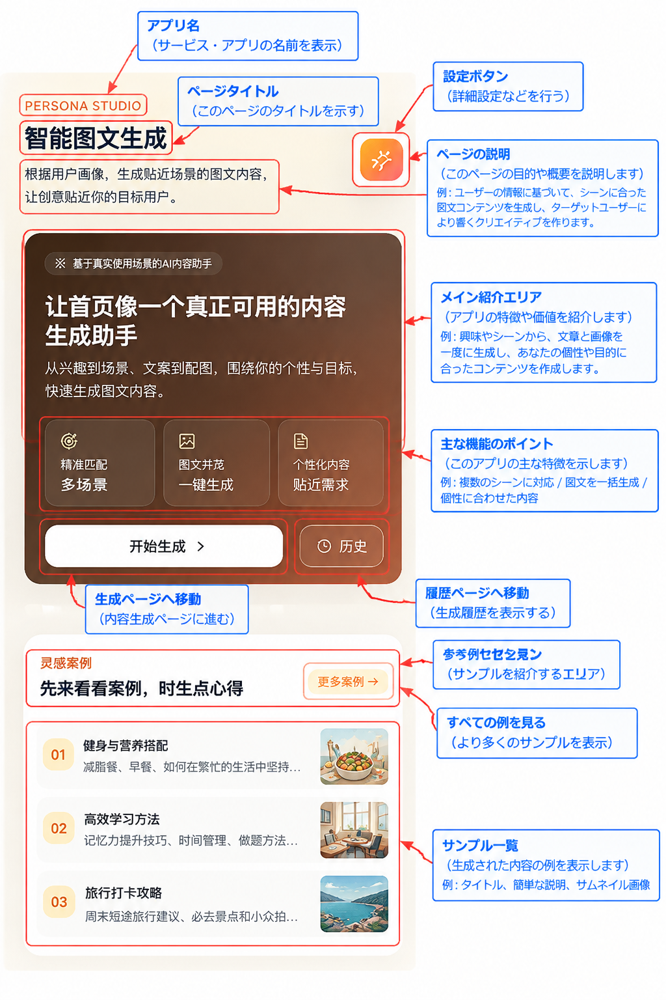
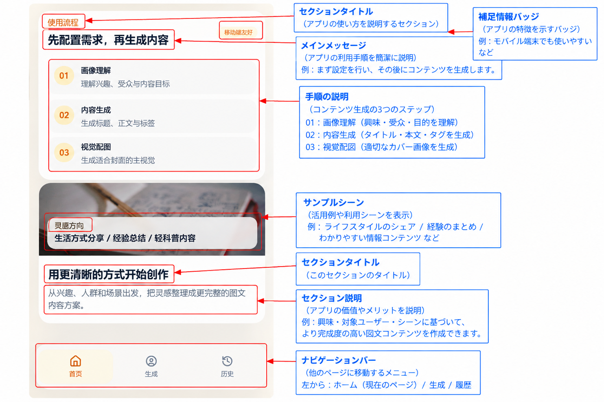
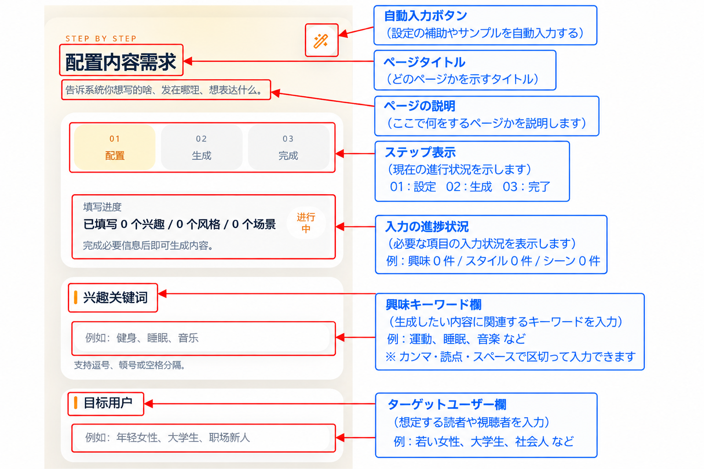
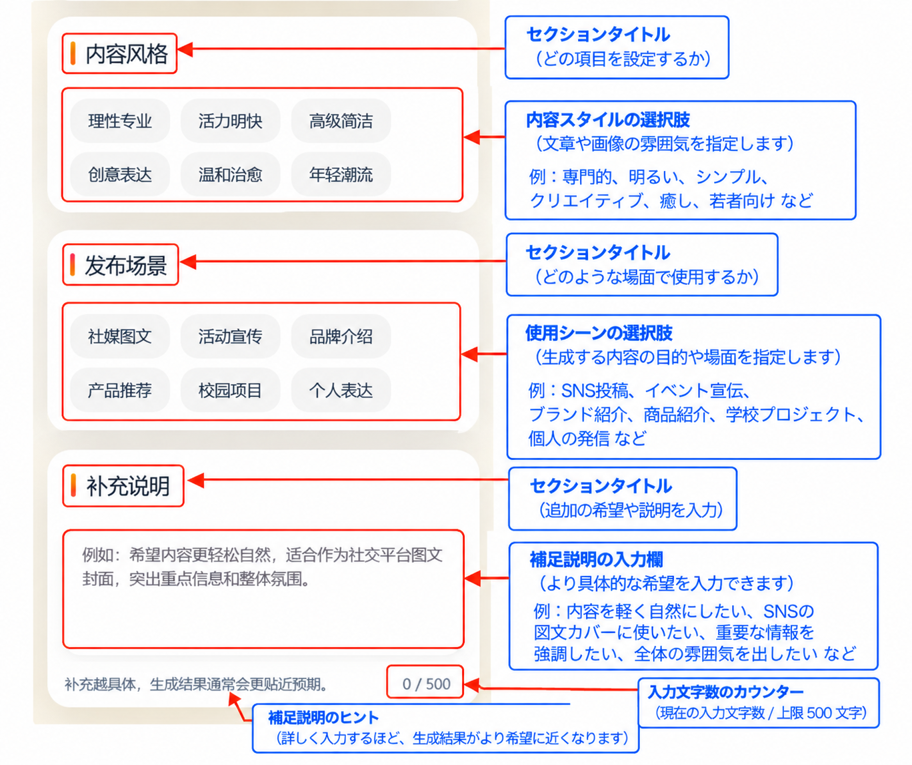
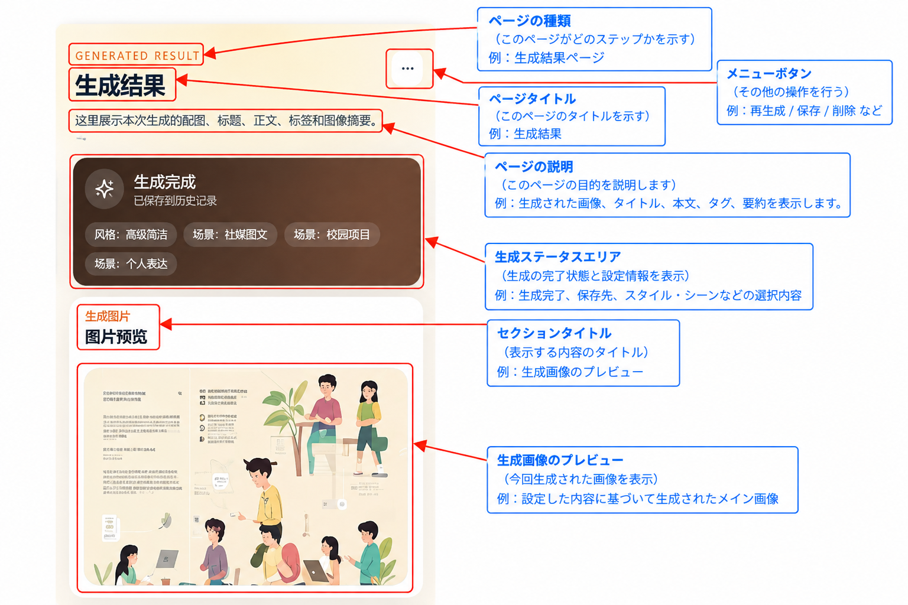
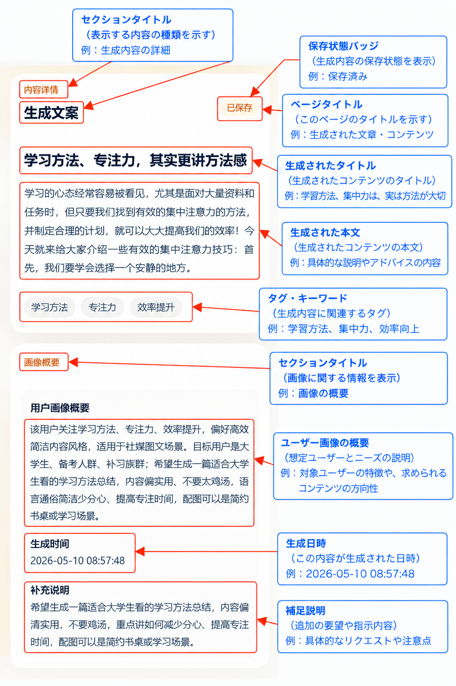
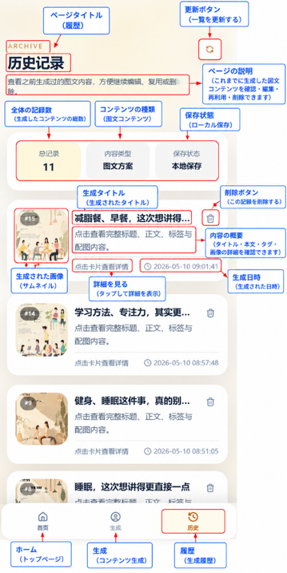
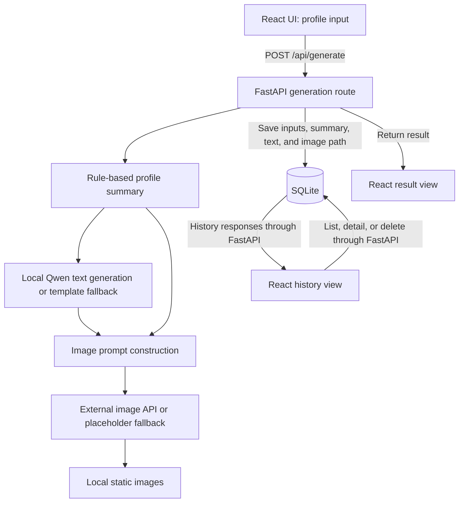

# Profile-Based AI Content Generator

## Overview

An individual undergraduate graduation project that combines a React frontend, a FastAPI backend, and SQLite to generate and review social-media content drafts.

Users provide interests, an intended audience, a writing style, a publishing scenario, and additional instructions. The backend builds a rule-based profile summary, generates a title, body, and tags with a local language model, and requests an image from an external service. Inputs and results are stored for later review.

The project focuses on integrating generation into a web application: form validation, API requests, output parsing, failure handling, and history management. It is a local prototype with a Chinese-language interface and Chinese-oriented text prompts.

## Japanese Summary

個人の学部卒業制作として開発した、ユーザーの関心や想定読者に応じて文章と画像を生成する Web アプリケーションです。
React と FastAPI を組み合わせ、ローカルでの文章生成、外部 API による画像生成、SQLite での履歴管理を実装しています。
入力情報をルールで整理し、文章と画像のプロンプトに共通の文脈を与える設計です。
現在は中国語 UI のローカル動作用プロトタイプであり、生成品質の定量評価や本番環境へのデプロイは行っていません。

## Screenshots

The screenshots include Japanese functional annotations. The application interface itself remains primarily Chinese; these annotations do not indicate Japanese-language UI support.

### Home Screen（ホーム画面）

The home screen introduces the application and provides entry points for content generation and saved history.

<p align="left">
  
</p>

### Generation Workflow（生成フロー）

The workflow section outlines profile interpretation, text generation, and image generation.

<p align="left">
  
</p>

### Content Configuration（コンテンツ設定）

The first part of the form shows input progress, interest keywords, and the target audience.

<p align="left">
  
</p>

The second part contains writing-style and publishing-scenario choices, followed by additional instructions.

<p align="left">
  
</p>

### Generation Result（生成結果）

The result overview shows completion status, selected settings, and the generated image preview.

<p align="left">
  
</p>

The content section displays the generated title, body, tags, profile summary, and generation details.

<p align="left">
  
</p>

### History（生成履歴）

The history page lists saved entries with thumbnails and timestamps, alongside refresh, detail, and delete controls.

<p align="left">
  
</p>

## Key Features

- Collect interests, audience, style, scenario, and additional instructions through a validated form.
- Build a profile summary from the supplied fields using explicit rules.
- Generate a title, body, and tags through local text inference, with template fallback.
- Construct image prompts from the profile and generated text, then save externally generated images locally.
- Display images and text separately, and copy the title and body to the clipboard.
- List, inspect, and delete saved history; regenerate content using a record's inputs.
- Show loading and error states, with separate request timeouts for generation and history operations.

## Tech Stack

| Area | Technology | Responsibility |
| --- | --- | --- |
| Frontend | React 18, TypeScript, Vite 6, React Router | Forms, navigation, API requests, and result/history views |
| Styling | Tailwind CSS 4, local UI components, Lucide React | Layout, controls, and icons |
| Backend | Python, FastAPI, Pydantic, Uvicorn | Request validation, generation orchestration, and HTTP endpoints |
| Persistence | SQLAlchemy, SQLite | Store inputs, profile summaries, generated text, and image paths |
| Text generation | Transformers, PyTorch, Qwen2.5 Instruct | Run a pretrained text model locally |
| Image generation | External Pollinations image endpoint, Python standard-library HTTP client | Request an image and download its bytes |
| Static assets | FastAPI StaticFiles, Pillow | Serve saved images and prepare a fallback placeholder |

The active database is SQLite; no MySQL server is required.

## Architecture



The generation route coordinates these steps sequentially. Image bytes are stored under `backend/app/static/generated/`; SQLite stores their paths rather than the image bytes.

The backend separates routes, request/response schemas, generation services, and persistence operations. The frontend centralizes HTTP requests in `frontend/src/app/api.ts`.

## Engineering Decisions & Challenges

### Prompt construction and output parsing

Both generators use the same input context. Keyword rules infer content categories and select writing tones or visual templates. Text prompts request `Title:`, `Content:`, and `Tags:` sections; parsing and post-processing normalize titles, paragraphs, and tags.

Image prompts also use the generated title and body to infer subjects and visual direction. Negative prompts are sent to discourage text overlays, watermarks, and poster-like layouts.

These are prompt-design strategies intended to encourage related text and imagery. Their effectiveness has not been measured, and the application does not calculate an automatic image-text consistency score.

### Local text inference and fallback

The text service first attempts `Qwen/Qwen2.5-0.5B-Instruct`. If loading fails, it attempts `Qwen/Qwen2.5-1.5B-Instruct`; if both fail, it returns template-based text. Inference failures also trigger template fallback, and missing output fields can be filled from templates.

The pipeline is loaded lazily and cached within the process. The code selects a CUDA device when available and otherwise uses the CPU. First use may require model downloads; inference speed and memory requirements have not been benchmarked.

This approach keeps text inference local after model acquisition, but adds runtime and dependency complexity. A returned text result may be template output rather than model output.

### External image requests and failure handling

The image service makes an HTTP GET request with a 90-second timeout, rejects empty responses, and saves downloaded bytes under a generated filename. Download or save exceptions trigger an attempt to return the local placeholder.

The frontend uses a 180-second generation request timeout and a 30-second default timeout. It displays request errors and resets loading state. These values are configured limits, not measured response times; aborting a browser request does not guarantee cancellation of backend work.

Fallback supports a degraded result, but does not guarantee request success. End-to-end AI generation and database-failure handling remain unverified. The backend does not currently return a structured flag identifying fallback output.

### Persistence and application scope

SQLite avoids a separate database server for local use. SQLAlchemy handles persistence, and the application initializes tables at startup.

Generation is synchronous within the request flow. There is no background job queue, authentication, or per-user history isolation. This simplifies the prototype but limits its suitability for a public multi-user service.

## Getting Started

**Verified on Windows:** Node.js 24.14.0, npm 11.9.0, and Python 3.12.10. Dependency installation, the Vite build, frontend/backend startup, and SQLite history API checks passed. API checks used an isolated temporary database.

**Not tested:** Qwen model loading/inference, the external image API, and the complete AI generation flow. macOS/Linux startup has not been verified.

### Prerequisites

- Node.js 22 or later with npm satisfies the declared Vite and React Router engine ranges in the lockfile. Only the Windows versions listed above have been verified.
- Python 3.10 or later is required by the backend syntax; Python 3.12.10 was used for the Windows verification above.
- Internet access for dependency installation, initial model downloads, and external image generation.
- A writable backend directory for SQLite and generated images. Hardware requirements have not been measured.

Python dependencies are currently unpinned, so installing the requirements may require compatibility adjustments.

### Backend

From the project root, use a separate terminal. The following commands use PowerShell and avoid virtual-environment activation:

```powershell
cd backend
python -m venv .venv
./.venv/Scripts/python.exe -m pip install -r requirements.txt
./.venv/Scripts/python.exe run.py
```

For macOS/Linux shells, the equivalent sequence is:

```bash
cd backend
python3 -m venv .venv
./.venv/bin/python -m pip install -r requirements.txt
./.venv/bin/python run.py
```

The macOS/Linux sequence is also unverified; it is provided as a platform equivalent, not a claim of tested platform support.

`run.py` starts Uvicorn on `127.0.0.1:8000` with development reload enabled. On startup, the app initializes the SQLite schema and prepares static directories.

When running locally:

- [Interactive API documentation](http://127.0.0.1:8000/docs)
- [Health endpoint](http://127.0.0.1:8000/api/health)

The health endpoint returns a static status; it does not test model readiness, database access, or the image provider.

### Frontend

In another terminal, start from the project root:

```bash
cd frontend
npm ci
npm run dev
```

Open the local address printed by Vite. The frontend currently sends API requests to the hardcoded `http://127.0.0.1:8000` address in `frontend/src/app/api.ts`.

`npm run build` completed successfully in the verified Windows environment.

## Environment Variables

No environment variables are required to select the default database.

| Variable | Required | Default | Purpose |
| --- | --- | --- | --- |
| `SQLITE_PATH` | No | `backend/app.db`, resolved from the backend source directory | Override the SQLite file location |

The backend loads dotenv configuration. If an override is needed, use `backend/.env.example` as a reference, replace its commented placeholder with a valid path, and save the local configuration as `backend/.env`. An absolute SQLite path avoids working-directory ambiguity.

The current image client does not read an API key from the environment. Its endpoint, requested model, and timeout are source constants; no API key variable is currently consumed by this integration.

Keep real `.env` files, databases, downloaded weights, and generated output out of version control. Image prompts include profile information and are transmitted in the external request URL; use non-sensitive demonstration inputs.

## API Overview

| Method | Path | Behavior |
| --- | --- | --- |
| `GET` | `/` | Return a backend message and documentation path |
| `GET` | `/api/health` | Return a static health status |
| `POST` | `/api/generate` | Generate content, save a history record, and return the result |
| `GET` | `/api/history` | List saved history summaries |
| `GET` | `/api/history/{record_id}` | Retrieve one record's inputs and generated content |
| `DELETE` | `/api/history/{record_id}` | Delete a history record |

`POST /api/generate` accepts `interests` (a nonempty string array), `style`, `scenario`, `target_user`, and optional `input_text`. The current frontend requires additional instructions, even though the API allows that field to be omitted.

The generation response contains `id`, `profile_summary`, `title`, `content`, `tags`, `image_url`, and `created_at`. Images are served under `/static/`. The local `/docs` page describes request and response schemas.

## Current Limitations

- The interface and text prompts are Chinese-oriented; multilingual UI support is not implemented.
- The form allows multiple style/scenario selections, but sends only the first selection from each group.
- The profile summary uses rules, not a trained profiling model. The active flow does not use semantic retrieval or automatic image-text scoring.
- Prompt constraints do not guarantee factual accuracy, image relevance, or text-free images. Generated content needs human review.
- The external image endpoint's current availability, accepted parameters, and returned image format have not been verified in this update.
- Image responses are checked for empty bytes, but are not decoded or stripped of metadata before saving.
- Fallback output is not identified explicitly in API responses, and broad exception handling limits diagnostics.
- Deleting a history record does not delete its saved image. History listing is unpaginated.
- Authentication, user isolation, rate limiting, and restricted production CORS settings are absent.
- No automated test suite, CI/CD pipeline, or production deployment configuration is provided. Dependency versions remain unpinned, so repeatability of future installations is not guaranteed.

## Future Improvements

These are planned directions, not implemented features:

- Establish a reproducible dependency/runtime setup and add API, parsing, and failure-path tests.
- Expose structured fallback/error states and validate downloaded image types, sizes, and metadata.
- Review prompts with a documented evaluation set before making quality claims.
- Make provider configuration and the frontend API address configurable.
- Improve style/scenario selection behavior, paginate history, and define image-retention behavior.
- Consider background jobs, authentication, and per-user storage before any multi-user deployment.

## Project Context

This is an individual undergraduate graduation project exploring how profile inputs can guide text and image generation within a web application.

Its scope is a local prototype integrating pretrained models and an external image service. No models were trained for this project. It has not been deployed as a production service, and no user-scale or commercial-use results are claimed.
